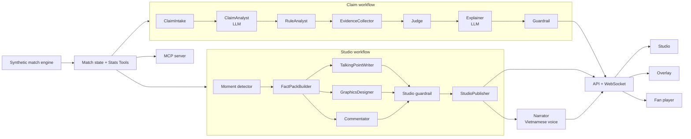

# Pundit Copilot

> **Synthetic data only.** Every team, player, referee and match is generated. Not affiliated
> with the Premier League or any club.

**An AI co-pilot for live football coverage: it checks what commentators say against the match
data before it goes on air, writes verified talking points and on-screen graphics, and gives
fans live Vietnamese commentary with a voice, explained for beginners.**

Built solo for the Microsoft × Premier League "Inside the Game" hackathon (categories: Grand
Prize, Best Multi-Agent System).

| | |
|---|---|
| Live demo | <https://hnam2501-pundit-copilot.hf.space> (one container on a Hugging Face Space, no login) |
| Demo video (< 2 min) | _added at submission_ |
| Results | [docs/eval.md](docs/eval.md) |

## Try it in three steps (no login)

1. Open the [live demo](https://hnam2501-pundit-copilot.hf.space) and press **Start my demo
   match**: you get a private match of your own, replayed at 20x.
2. In the studio, type the claim **"Đội nhà áp đảo hiệp 2"** ("the home side dominated the
   second half"): the verdict and its numbers arrive in under a second, the model's explanation
   follows.
   Open **Why · Evidence · Agent Trace**, then **Agent Ops** to watch the agents, and **Chaos**
   to break the model ("the model lies") and see the guardrail block it.
3. Open **Fan**, choose Vietnamese, beginner mode and **Turn the voice on**: the commentary is
   read aloud as the match goes. The voice is the browser's: Edge on a desktop has natural
   Vietnamese voices (female and male); an iPhone has one system voice.

AI assistants can query the same statistics over MCP at
`https://hnam2501-pundit-copilot.hf.space/mcp` (Streamable HTTP, read-only, [docs/mcp.md](docs/mcp.md)).
The Space is kept awake by three independent layers (the app pings itself, a GitHub Actions
watchdog restarts it, an outside uptime monitor alerts); if it was restarted, press **Start my
demo match** again.

## The problem

Live commentary is fast and unforgiving. A pundit says "they dominated the second half" and
nobody can check it before it airs. Graphics teams build lower-thirds by hand. And most fans
around the world follow a match in a language that is not English, often new to the game's rules.

## What it does

**For the studio** (commentators, editors):

- **Claim check.** Type or speak a claim, in Vietnamese or English ("Đội nhà áp đảo hiệp 2",
  "Kestrel took more shots than Harbor"). The answer is a verdict (true, partly true, false, not
  enough data) with the numbers behind it and the event IDs they come from. It comes twice: from
  the rules in under a second, then refined by the model, which explains it in words; the rules'
  verdict stands unless the rules could not read the claim.
- **Talking points** at every key moment: two or three verified lines, to approve, pin or dismiss.
- **Lower-thirds** that go on air by themselves (take, hold, clear by hand), as a transparent
  overlay page for OBS or vMix.
- **Why · Evidence · Agent Trace** for every item: the facts, the events on a pitch map, and
  which agent did what, with timings.
- **Agent Ops**: the agents of the match at work, live: who runs, the typed message each one
  hands on, the match state the run reads, what the guardrail blocked, the breakers.
- **Chaos**: in your own demo match, break the model (down, slow, garbage, rate limited,
  content filter, or lying with one number changed) and watch the system recover.

**For fans**:

- **Live commentary in Vietnamese or English**, read aloud from a spoken script the server
  checks (numbers written as words): goals, chances, saves, corners, offsides, VAR, cards, but
  also tackles, fouls and passes into the box, and a statistics update every five minutes,
  110–154 verified lines a match; faster and higher on a goal. In the public demo the browser's
  Vietnamese voice reads it.
- **Beginner mode** explains offside, VAR, penalties… the first time they happen.
- **Personalised**: analyst (dense numbers) or casual (plain words), a favourite club, one player
  followed all match, one metric only. The same moment, written two ways: see the compare page.
- **Recaps** at half-time and full time, text and audio.

**For AI assistants**: the match statistics as a read-only **MCP server** (stdio and
`/mcp`), so GitHub Copilot, Claude or a broadcaster's system can ask the same tools the studio
uses ([docs/mcp.md](docs/mcp.md)).

## The rule: no evidence, no number

Every number a user sees comes from deterministic statistics tools, never from a language model.
The model only reads the claim and writes sentences; a **guardrail** checks each sentence before
it is published (every number must match a fact, comparisons and attributions must hold, a model
may not invent a minute or a ratio) and falls back to a template when the model fails. An
independent audit counts the numbers in published text that have no source: **0** in every
evaluation run.

## How it works

The hackathon's pipeline, end to end:

| Step | In Pundit Copilot |
|---|---|
| **Ingest** | A synthetic match engine generates realistic event streams (passes, shots, cards, VAR, substitutions) from a seed, replayed live at 1x–1000x |
| **Interpret** | Match state, 33 deterministic metrics (possession by ball-in-play time, xG, PPDA, momentum, control vs chaos, tempo…), moment detection |
| **Explain** | Agents turn moments and claims into verified sentences with their evidence |
| **Render** | Timestamped, machine-readable output over WebSocket: studio dashboard, overlay page, fan player, recaps, audio clips |
| **Personalize** | Each viewer's connection gets its own rendering: register, language, club, player, beginner mode, voice |



### The agents

| Agent | Role | Model |
|---|---|---|
| ClaimIntake | Language, time scope, the match at that minute | No |
| ClaimAnalyst | Reads the claim into a typed spec (subjects, metrics, windows) | LLM, within a budget |
| RuleAnalyst | A rule parser that always cross-checks the model's reading; the rules win when they disagree, and a reading only the model made must be said by the claim's words | No |
| EvidenceCollector | Calls the Stats Tools for every assertion | No |
| Judge | Verdict from the facts with written tolerances | No |
| Explainer | Writes the explanation from the facts | LLM, within a budget |
| Guardrail | Rejects any sentence whose numbers, relations, minutes or tone do not hold; template fallback | No |
| Moment detector | Goals, big chances, VAR, momentum swings, half-time… | No |
| FactPackBuilder | The facts a moment may cite | No |
| TalkingPointWriter · GraphicsDesigner · Commentator | Talking points, lower-thirds, commentary in four versions (VI / EN × analyst / casual), in parallel | LLM, within budgets |
| RecapWriter | Half-time and full-time recaps | LLM |
| Narrator | Spoken script (numbers written as words, checked back), prosody, audio clips | No (a voice: the browser's in the demo; Azure AI Speech supported) |

**Multi-agent design.** The agents share one match state pinned at an event (`as_of`), hand off
typed messages through **Microsoft Agent Framework** workflows (sequential for claims, fan-out /
fan-in for the studio), and recover from failure: per-role budgets, circuit breakers that open
and close again, deterministic templates, a plain asyncio runner if the workflow itself fails.
Every run leaves a trace shown in the UI, and the Agent Ops page streams the runs as they happen.
A fault-injection proxy in front of the model checks 13 failure modes (hangs, 500s, 429s,
garbage, content filters, flaky answers): the studio and the claim checker keep answering, on
time, in all of them. The same faults can be switched on by a judge in a private match; another
match, and its breakers, never see them.

## Results

From [docs/eval.md](docs/eval.md): 100 claims on three matches (72 labelled, 28 held-out written
apart and frozen before any parser change).

| Measure | Target | Rules + templates (mock model) | Local model (qwen2.5:3b, CPU) |
|---|---|---|---|
| Accuracy, labelled set | ≥ 85 % | 96 % | 97 % |
| Wrong verdicts | 0 | 0 | 0 |
| Held-out coverage | ≥ 70 % | 64 % | 75 % |
| Numbers with no source in published text | 0 | 0 of 274 | 0 of 188 |
| Prompt injections judged true | 0 | 0 | 0 |

**On the public Space** (2 vCPUs, `qwen2.5:1.5b`, the same 100 claims sent over the internet):
96 % accuracy on the labelled set, 0 wrong verdicts; the rules answer in 281 ms (p50, round
trip); the model pass, waited for, takes 39 s at p50 and 55 s at p95 and refines 51 of 100
claims. It also wrote one invented scoreline ("won 2-0" for a team that lost), which the
audit caught and a new guardrail rule now blocks. **With Microsoft Foundry Local**
(`phi-4-mini` on a laptop CPU, 20 claims): 100 % accuracy, 0 wrong verdicts, 0 invented
numbers, about 5.5 minutes a claim. Details: [docs/eval.md](docs/eval.md).

Refusing is allowed, misleading is not: a claim the system cannot read is answered "not enough
data". The notes of docs/eval.md keep the first measurements and every fix a wrong verdict led to.

**A model that lies.** With Chaos's "the model lies" (valid answers with one number changed), a
full match and its claims gave over 100 wrong texts: the guardrail rejected every one, and none
was published (backend/tests/api/test_chaos.py).

Quality gates: 2,700+ backend tests (95 % coverage), 200+ frontend unit and component tests, 46
end-to-end tests, the judge's demo path run on the public Space (Edge, Chrome, an emulated
phone) and heard on a real iPhone, accessibility (axe) on every page in both themes and
languages, secret and Official Rules scans on the whole git history. Every commentary phrasing
is checked by the guardrail as if a model had written it, on twelve generated matches.

## How it meets the judging criteria

| Criterion | Where to look |
|---|---|
| **Technological implementation** | A seeded synthetic match engine (realistic event streams, three story scenarios); 33 deterministic metrics with evidence event IDs; 2,700+ tests; CI → GHCR → Space deploy by image digest; a self-healing watchdog |
| **Agentic design & innovation** | Microsoft Agent Framework workflows (sequential claim pipeline, fan-out / fan-in studio), typed handoffs over one shared match state, a guardrail agent that can veto any sentence, progressive answers (rules first, model second), circuit breakers and fault injection, the live Agent Ops view, a read-only MCP server |
| **Real-world impact** | Broadcasters never air an unchecked number; editors get verified talking points and on-air graphics; fans get live commentary in their own language, explained for beginners; runs in one CPU container, on premises, without a cloud account |
| **User experience & presentation** | One-click private demo, studio / overlay / fan / compare pages in Vietnamese and English, beginner mode, voice, light and dark themes, accessibility checked; a demo video under two minutes |
| **Category: Best Multi-Agent System** | Distinct roles (table above), shared state pinned at an event, typed messages, recovery on failure (13 failure modes, Chaos per match), the full trace in the UI, and a result no single agent gives: a model that is allowed to write but never to invent a number |

## Microsoft technologies

This project had **no Azure subscription** (the free offer was refused for the account), so
nothing below runs on Azure. The table says what runs and where.

| Technology | How it is used | Status |
|---|---|---|
| **Microsoft Agent Framework** | The claim and studio workflows (executors, typed messages, fan-out / fan-in) | In use, in the public demo |
| **Microsoft Foundry Local** | Runs `phi-4-mini` on the developer's machine through the same OpenAI-compatible client as Foundry; used to evaluate the claim checker | In use for evaluation (20 claims, [docs/eval.md](docs/eval.md)) |
| **MCP** | The read-only statistics server (stdio and `/mcp`, 9 tools) | In use, in the public demo |
| **GitHub Actions + GHCR** | Tests, the evaluation gate, secret and compliance scans; builds the images, pushes them to GHCR and deploys the Space by image digest, then smoke-tests it | In use |
| **GitHub Copilot Agent Mode** | A client of the MCP server, and the author of the keepalive watchdog ([docs/copilot.md](docs/copilot.md)) | Setup ready; runs pending |
| Microsoft Foundry (cloud), Azure AI Speech, Azure Container Apps, Application Insights | Foundry client with Entra ID, Vietnamese neural voices by REST with SSML, Bicep / `azd` infrastructure (`infra/`, `azure.yaml`) | **Azure-ready, not deployed**: built and tested against deterministic mocks only |

## Deployment

The public demo is **one container on a free Hugging Face Space** (2 vCPU, no GPU), built from
this repository by GitHub Actions ([.github/workflows/space.yml](.github/workflows/space.yml)):
the API, the static UI, `/mcp` and an open model on the CPU (Ollama, `qwen2.5:1.5b`, Apache-2.0)
for the claim checker only. The studio writes from its templates there: a CPU model cannot meet
its 2.5–3 s budgets. Three layers keep it awake: the app pings its own public URL, a GitHub
Actions watchdog ([.github/workflows/watchdog.yml](.github/workflows/watchdog.yml)) restarts the
Space when it sleeps or fails and opens an issue, and an outside uptime monitor checks
`/healthz` every five minutes. A broadcaster
could run the same image on premises or in an outside-broadcast truck: the data never leaves the
machine and nothing needs a cloud account. Design and measurements:
[docs/day7-design.md](docs/day7-design.md).

## Run it locally

Requirements: Python 3.12 with [uv](https://docs.astral.sh/uv/), Node.js 22.

```bash
cd frontend && npm ci && npm run build && cd ..
uv run --project backend pundit serve --ui frontend/out    # http://127.0.0.1:8000
```

Or with Docker:

```bash
docker build -t pundit-copilot .
docker run -p 8000:8000 pundit-copilot

# the image of the public demo: the same app plus Ollama and its model on the CPU
docker build -f deploy/space/Dockerfile -t pundit-copilot-space .
docker run --cpus 2 -p 8000:8000 pundit-copilot-space
```

Open the landing page and press **Start my demo match**. No account is needed. The default runs
with a deterministic mock model and mock voice; real models are switched on by environment
variables (names in [backend/.env.example](backend/.env.example)).

Useful commands:

```bash
uv run --project backend pundit claim --scenario dominant_loser --seed 42 "Đội nhà áp đảo hiệp 2"
uv run --project backend pundit eval --min-accuracy 0.85
uv run --project backend pundit mcp                 # the MCP server over stdio
```

## Repository

| Path | What |
|---|---|
| `backend/` | Python 3.12: match engine, Stats Tools, agents, workflows, API, speech, MCP server |
| `frontend/` | Next.js (static export): landing page, studio, overlay, fan player, compare page |
| `packages/schemas/` | JSON Schemas shared by both sides |
| `deploy/space/` | The Hugging Face Space image: Ollama on the CPU, start script, defaults |
| `infra/`, `azure.yaml` | Bicep / `azd` for Azure (not deployed) |
| `docs/` | Designs and as-built notes per day, evaluation, MCP, Copilot |
| `tools/security/` | Secret and Official Rules scanners |
| `tools/ops/` | Deploy and smoke-test scripts of the Space |

## Synthetic data and responsible use

- No real league, club, player or referee name, logo or data; a scanner checks the product code
  and data for real names on every CI run, and every screen carries a "Synthetic data" label.
- Unsafe or demeaning language about players, clubs or officials is blocked by the guardrail
  (and by the provider's content filter when the model runs on Foundry); a blocked text is never
  published.
- Most of the code was written with Claude Code (Anthropic).
